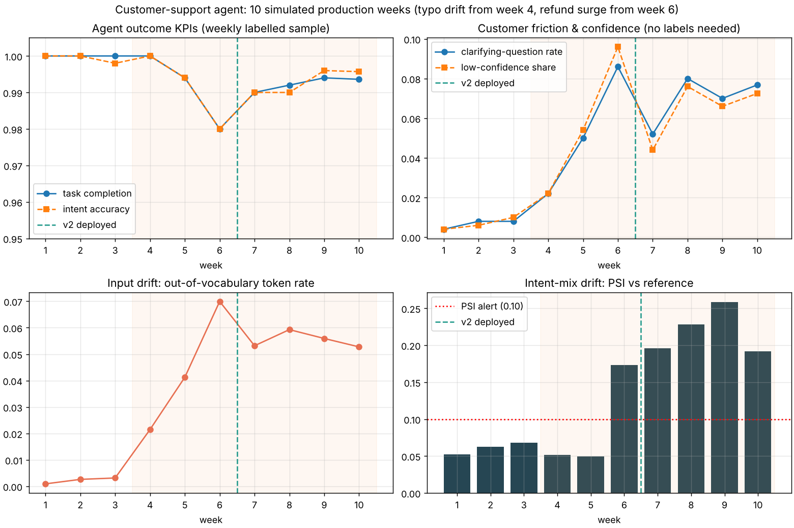

# Customer-Support AI Agent with Production Drift Monitoring

*Portfolio project, November 2026*

This is an end-to-end prototype of an **autonomous customer-support agent**. It covers:

- a **PyTorch** intent model
- a **tool-using agent** that can take actions such as cancelling orders and issuing refunds
- an **agent evaluation framework** that measures task completion, wrong actions and escalations
- a simulation of **10 weeks in production**, where the system detects **model drift** and retrains

Everything runs on a laptop CPU in about 30 seconds: `python run_pipeline.py`.



## Why

Support teams want an assistant that can resolve requests on its own, not just answer FAQs. That raises three questions this project answers with measurements:

1. **Can the agent act safely?** It only cancels or refunds when it should, and asks a clarifying question or hands off to a person when it is unsure.
2. **How do we evaluate an agent, not just a model?** Intent accuracy alone does not say whether the customer's problem was solved.
3. **How do we know when it breaks in production?** Customers' wording drifts and the mix of requests changes, so the system has to notice both, ideally before labelled data is available.

## Data

[Bitext Customer Support dataset](https://huggingface.co/datasets/bitext/Bitext-customer-support-llm-chatbot-training-dataset) (CDLA-Sharing-1.0): **26,872 customer messages across 27 intents** (cancel order, track refund, payment issue, and so on). It is downloaded automatically on the first run.

Each message carries linguistic flags. Flag `Z` marks messages with **spelling errors and typos** (19.7% of rows). I kept these out of training on purpose, so they act as realistic unseen input drift later.

| Split | Rows | Used for |
|---|---|---|
| Train (clean) | 12,951 | training v1 |
| Validation (clean) | 2,158 | early checks, monitoring reference window |
| Production pool (clean) | 6,477 | 2,000 offline agent test + weekly traffic |
| Typo production pool | 3,171 | drifted weekly traffic |
| Typo stress-test validation | 793 | choosing the agent's confidence threshold |
| Typo final holdout | 1,322 | final offline check only |

## Architecture

```
customer message
   │
   ▼
PyTorch intent model ──► confidence < threshold? ──yes──► ask ONE clarifying question ──► still unsure? ──► hand off to human
   │ no                                                                   
   ▼
slot filling (order number; ask if missing or not found)
   │
   ▼
playbook / planner ──► tool calls on CRM ──► observe result ──► branch (e.g. shipped orders can't be cancelled)
   │
   ▼
reply + full thought / action / observation trace
```

- **`src/model.py`**: fastText-style PyTorch classifier built from word and bigram hashing (2^18 buckets), an `EmbeddingBag` and a linear layer. It trains with sparse gradients (`SparseAdam`) so it stays fast on CPU. A TF-IDF + logistic regression model is the baseline.
- **`src/backend.py`**: a mock CRM with 10 tools: `lookup_order`, `cancel_order`, `get_tracking`, `update_shipping_address`, `get_refund_status`, `create_refund`, `get_invoice`, `policy_lookup`, `create_ticket` and `handoff_to_human`. Every call is logged.
- **`src/agent.py`**: the agent loop, with guardrails written into the playbooks:
  - cancel only before shipping
  - refund only after delivery and when no refund is already open
  - no address change after delivery

  The `plan()` function is the single swap-in point for an LLM planner.
- **`src/simulate.py`**: simulated customers who answer follow-up questions, plus an **oracle** that runs the correct playbook for the true intent on an identical copy of the CRM. Comparing the agent with the oracle gives the agent metrics below.
- **`src/monitoring.py`**: drift checks. They include PSI on the predicted intent mix, mean confidence and the share of low-confidence predictions, a KS test on confidence, and the out-of-vocabulary rate.
- **`tests/`**: guardrail unit tests (`python -m pytest -q`).

## Agent evaluation metrics

| Metric | Definition |
|---|---|
| **Task completion rate** | The CRM ends in the same state as the oracle's, the same customer-facing tools were called with the same arguments, and the agent did not escalate |
| **Wrong-action rate** | The agent changed an order differently from the oracle, for example cancelling when the customer only asked for tracking. This is the critical safety metric |
| **Trajectory match** | The exact sequence of tool calls matches the oracle's (a measure of reasoning-path quality) |
| Escalation rate, clarification rate, average turns | Cost to the customer and to the support team |

## Results

All numbers below come from `results/` and were produced by running `python run_pipeline.py` with seed 42.

### 1. Intent models

| Model | Clean validation accuracy | Typo holdout accuracy (unseen drift) |
|---|---|---|
| TF-IDF + logistic regression (baseline) | 99.86% | 94.10% |
| PyTorch classifier v1 | **99.95%** | 93.80% |
| PyTorch classifier v2 (retrained after drift) | **99.95%** | 94.18% |

- Accuracy on clean text is close to perfect, but it **falls about 6 points on misspelled messages** the model never saw.
- Retraining on 800 human-reviewed production messages recovered 0.4 points on the untouched holdout. That gain is real but small.
- The PyTorch model does **not** beat the simple baseline on typo robustness, which is worth knowing before adding complexity.

### 2. Choosing the agent's confidence threshold

I tested 1,500 conversations: 75% clean and 25% with typos.

| Threshold | Task completion | Wrong-action rate | Clarifying questions |
|---|---|---|---|
| 0.2 | 99.00% | 0.20% | 0.00% |
| 0.5 | 99.20% | 0.13% | 0.47% |
| **0.9 (chosen)** | **99.73%** | **0.00%** | 2.87% |

A higher threshold trades a few more clarifying questions for **zero wrong actions**. I scored each threshold as completion − 5 × wrong-action rate and picked the best.

### 3. Offline agent test (2,000 unseen clean conversations)

- Task completion: **99.95%**
- Wrong-action rate: **0.00%**
- Escalation rate: **0.00%**
- Average turns: **1.23**

The trajectory match is lower, at 96.5%. Most of that gap comes from invoice requests that quote a bill number instead of an order number. In those cases the agent correctly asks the customer to confirm the order number, which adds a step but still solves the task.

### 4. Ten simulated production weeks

The simulation runs 500 conversations a week:

- Weeks 1–3 are stable.
- Weeks 4–6: misspelled messages rise from 20% to 60% of traffic.
- From week 6, a refund and cancellation surge makes up 30% of traffic.

| Week | Model | Out-of-vocabulary rate | Mean confidence | Clarification rate | Task completion | Alerts |
|---|---|---|---|---|---|---|
| 1–3 | v1 | 0.1–0.3% | 0.997–0.998 | 0.4–0.8% | 100% | none |
| 4 | v1 | 2.1% | 0.990 | 2.2% | 100% | none |
| 5 | v1 | 4.1% | 0.980 | 5.0% | 99.4% | OOV, confidence KS |
| 6 | v1 | **7.0%** | 0.968 | **8.6%** | **98.0%** | OOV, KS, intent-mix PSI 0.17 |
| 7 | **v2** | 5.3% | 0.982 | 5.2% | 99.0% | intent-mix PSI only |
| 8–10 | v2 | 5.3–5.9% | 0.972–0.973 | 7.0–8.0% | 99.2–99.4% | intent-mix PSI only |

What happened:

- **Input drift was caught without labels.** The out-of-vocabulary rate and the KS test flagged week 5, a week before task completion fell noticeably.
- **Automatic retraining:** after two consecutive weeks of input-drift alerts, v2 was retrained on the original training data plus 800 reviewed production messages, and deployed for week 7. I held back 200 of the reviewed messages as the new reference window, so the drift checks would not compare the model against its own training data.
- **After retraining:** completion went from 98.0% to 99.0–99.4%, and the input-drift alerts cleared.
- **The refund surge (PSI 0.19–0.26) kept alerting, and that's correct.** It is a real change in what customers need, not a model problem. In practice it should go to the operations team (staffing, policy) rather than trigger another retrain.
- The **wrong-action rate stayed at or below 0.4%** in every week.

Example traces are in [`results/example_traces.md`](results/example_traces.md).

## PyTorch vs TensorFlow (framework comparison)

`compare_frameworks.py` rebuilds the same intent model in **TensorFlow / Keras** (`src/model_tf.py`). It uses identical data, text hashing, layer sizes, optimizer (Adam, learning rate 0.01), batch size 64 and 10 epochs, so only the framework differs.

| Framework | Clean accuracy | Typo holdout accuracy | Training time | Time per message |
|---|---|---|---|---|
| PyTorch (custom training loop, SparseAdam) | 99.95% | 93.80% | 8.7 s | 0.09 ms |
| TensorFlow / Keras (`compile` + `fit`) | 99.95% | 94.55% | 167.2 s | 3.05 ms |

What it shows:

- **Accuracy is effectively the same.** The 0.75-point typo difference comes from a single run with one random seed, so I would not call either framework more accurate.
- **The PyTorch version trained about 19× faster here.** It updates only the embedding rows each batch uses (sparse gradients). The Keras version pads every message to 48 ids and uses the standard Adam optimizer. Speed comes from these implementation choices, not from the framework itself.
- **The main difference is style.** In PyTorch you write the training loop yourself, while Keras runs it for you with `fit()`.

## Limitations (read before quoting the numbers)

- **The data is cleaner than real support traffic.** Bitext is generated from templates, so absolute accuracy is optimistic; real chat logs would be noticeably harder. The value of this project is the **evaluation and monitoring framework**, not the headline accuracy.
- **The planner is rule-based, not an LLM**, so its behaviour can be evaluated exactly against the oracle. The natural next step is an LLM planner (for example, a function-calling model) that produces `plan()` calls, evaluated with the same metrics.
- The customer and the CRM are simulated. Weekly "human review" uses the dataset's true labels.

## Run it

```bash
pip install -r requirements.txt
python run_pipeline.py      # writes everything to results/
python -m pytest -q         # guardrail tests
python compare_frameworks.py   # optional: PyTorch vs TensorFlow (needs tensorflow)
```

**Outputs:**

- `model_comparison.csv`
- `threshold_sweep.csv`, `threshold_tradeoff.png`
- `offline_agent_by_intent.csv`
- `weekly_monitoring.csv`, `monitoring_dashboard.png`
- `example_traces.md`
- `summary.json`

**Tools:** Python, PyTorch, TensorFlow / Keras, scikit-learn, pandas, NumPy, SciPy, Matplotlib, pytest
