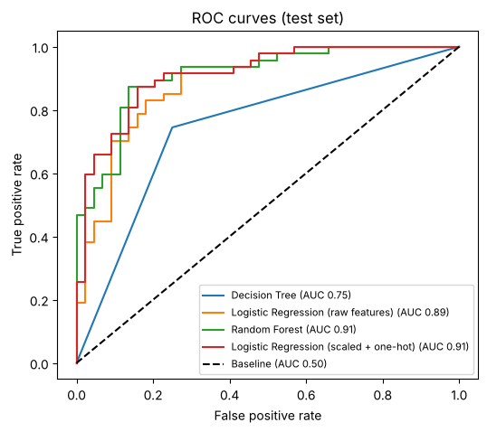
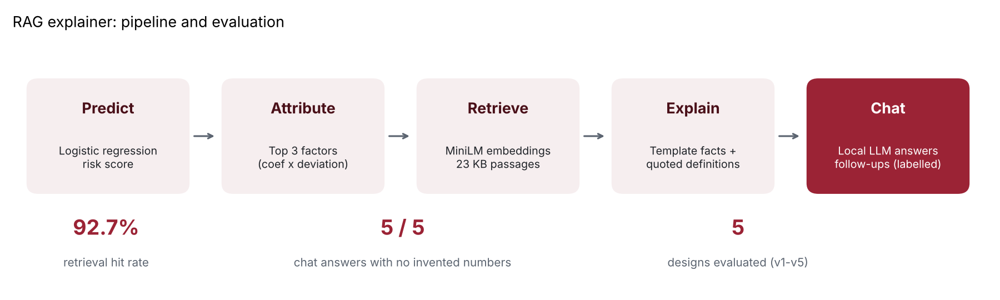

# Heart Disease Prediction

**Report and slides:** [PDF report](heart_disease_prediction_report.pdf) | [PowerPoint presentation](heart_disease_prediction_presentation.pptx) | [Notebook](heart_disease_prediction.ipynb)

**Question:** Can routine clinical measurements predict whether a patient has heart disease, and which factors matter most?

**Data:** [UCI Cleveland Heart Disease](https://archive.ics.uci.edu/dataset/45/heart+disease) dataset (`data/heart.csv`): 303 patients, 13 clinical features (age, sex, chest pain type, blood pressure, cholesterol, max heart rate, ST depression, vessel count, thal), binary target.

**Method**
- EDA: distributions, outcome rates by chest-pain type, correlation matrix
- 70/30 train-test split plus 10-fold stratified cross-validation
- Models: majority-class baseline, decision tree, logistic regression (raw and with scaling + one-hot encoding of categorical codes), random forest
- Metrics: accuracy, ROC-AUC, precision, recall, F1; ROC curves; model coefficients

## Results
| Model | Test accuracy | ROC-AUC | 10-fold CV accuracy |
|---|---|---|---|
| Majority-class baseline | 0.52 | 0.50 | 0.55 |
| Decision Tree | 0.75 | 0.75 | 0.75 |
| Logistic Regression (raw features) | 0.81 | 0.89 | 0.82 |
| Random Forest | 0.84 | 0.91 | 0.83 |
| **Logistic Regression (scaled + one-hot)** | **0.85** | **0.91** | **0.85** |

- Accuracy improved from a **0.52 baseline to 0.85** (ROC-AUC 0.91); cross-validation confirms the result.
- Recall of 0.89: few true heart-disease cases are missed, which matters for screening.
- Strongest signals: number of major vessels, chest pain type, thal result, sex, ST depression and maximum heart rate.

## Generative AI extension: RAG explainer
A retrieval-augmented explainer and chat app for the model's predictions ([genai_explainer/](genai_explainer/)): sentence-transformer retrieval over a 23-passage knowledge base, template-generated facts, and a local LLM (Qwen2.5-1.5B-Instruct) for follow-up questions. **Retrieval hit rate 92.7%; 5 of 5 chat answers with no invented numbers**, after evaluating five designs.

