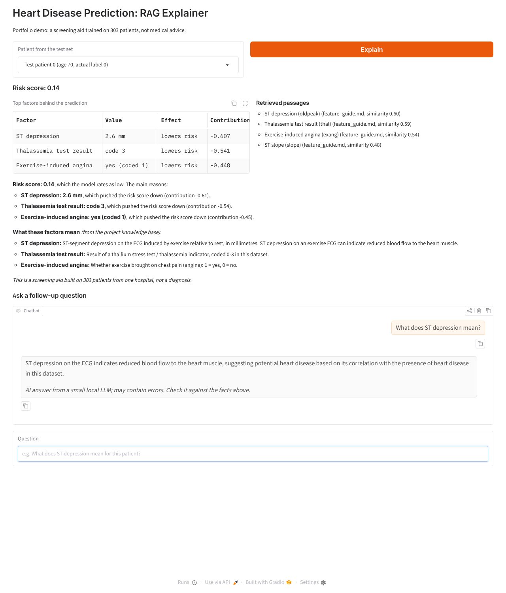

# RAG Explainer for the Heart Disease Model

A retrieval-augmented generation (RAG) pipeline that explains the logistic regression's prediction for a patient in plain language, grounded in project documentation.

**Pipeline:** predict risk → find the patient's top 3 contributing factors → retrieve matching passages from `knowledge_base/` using `all-MiniLM-L6-v2` sentence embeddings → template states the facts and quotes the retrieved definitions → a local LLM (`Qwen2.5-1.5B-Instruct` via Hugging Face transformers; Ollama or OpenAI optional) answers follow-up questions, labelled as AI-generated.

## Results
| Metric | Result |
|---|---|
| Retrieval hit rate (top-3 factor passages in top 4 retrieved, 91 test patients) | **92.7%** |
| Explanation facts (risk, values, directions) correct | **100%** (generated by code) |
| Chat answers with no invented numbers (5 test questions) | **5 / 5** |

## Five designs, evaluated
| Version | Design | What the evaluation found |
|---|---|---|
| v1 | LLM writes everything, raw codes | Called a female patient "male", misread values, contradicted the score; 4 factual errors |
| v2 | + readable values, strict rules | Sex and directions fixed; still misread numbers and invented statistics ("62% accurate") |
| v3 | Template facts + LLM context | Facts correct; LLM context drifted ("maximum heart rate measured at rest") |
| v4 | Template facts + LLM paraphrases definitions | No invented numbers in explanations, but skipped factors and invented details |
| **v5** | **Template facts + quoted definitions; LLM only for labelled chat** | Final design (results above) |

**Lesson:** a small local LLM is fluent but unreliable with numbers and specifics, so the final design keeps it away from anything that must be correct. In app testing it still once misstated a direction in a chat answer, which is why answers are labelled and the facts are always shown alongside. A larger model (Llama 3.2 3B, GPT-4o-mini) is the next step.

| File | Purpose |
|---|---|
| `rag_core.py` | Model, factor attribution, retrieval, prompt and LLM call |
| `rag_explainer.ipynb` | Walkthrough with three example patients and evaluation |
| `app.py` | Gradio chat app: pick a patient, get an explanation, ask follow-ups |
| `knowledge_base/` | Feature guide (built from the data), model guide, metrics guide |

**Run:** see [GENAI_SETUP.md](../../GENAI_SETUP.md). *Screening-aid demo, not medical advice.*
