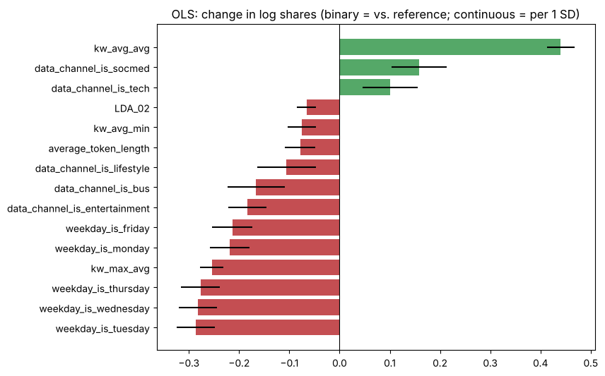
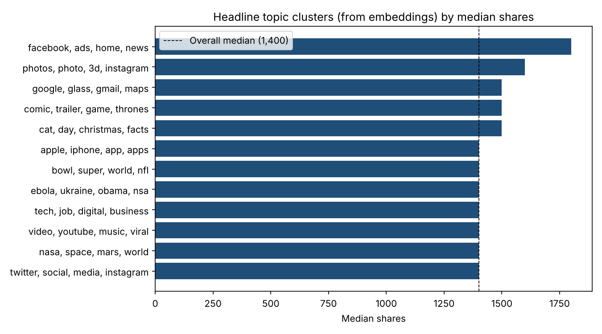

# Online News Popularity: Drivers of Article Shares

**Report and slides:** [PDF report](online_news_popularity_report.pdf) | [PowerPoint presentation](online_news_popularity_presentation.pptx) | [Notebook](online_news_popularity.ipynb)

**Questions:** Which article characteristics are associated with more shares? Can popularity (more than 1,400 shares) be predicted? Does headline text add signal?

**Data:** [UCI Online News Popularity](https://archive.ics.uci.edu/dataset/332/online+news+popularity): 39,644 Mashable articles, 58 features (content, links, media, keywords, publish day, channel, LDA topics, sentiment).
The CSV (about 24 MB) is not stored in this repo. Download `OnlineNewsPopularity.csv` from the link above and place it in `data/`.

**Method**
- EDA on skewed share counts, channel and weekday effects
- **Driver analysis:** OLS regression with controls on log shares, standardised features, redundant dummies removed
- **Prediction:** majority baseline, logistic regression, gradient boosting (stratified 80/20 split)
- **Text experiment:** headlines extracted from URL slugs, TF-IDF (unigrams + bigrams), tested alone, combined with numeric features, and as an out-of-fold score in gradient boosting
- Permutation importance for the best model

## Results
| Model | Accuracy | ROC-AUC |
|---|---|---|
| Majority-class baseline | 0.507 | 0.500 |
| Logistic Regression | 0.651 | 0.701 |
| **Gradient Boosting** | **0.664** | **0.728** |
| Headline TF-IDF only | 0.519 | 0.526 |
| Gradient Boosting + headline score | 0.667 | 0.728 |

- Gradient boosting lifted ROC-AUC from 0.50 to **0.73**.
- **Headline text added no lift** (AUC 0.728 → 0.728): popularity depends more on keyword, channel and timing context than on headline wording.
- **Drivers (OLS, R² = 0.13):** keyword strength is the largest effect; articles published Monday–Friday get about 20–25% fewer shares than Sunday articles (median 1,300–1,500 vs. 1,900–2,000 on weekends); Social Media and Tech outperform, while Entertainment, Business and World underperform.

## Generative AI extension: LLM headline embeddings
[llm_headline_embeddings.ipynb](llm_headline_embeddings.ipynb) embeds all 39,644 headlines with the `all-MiniLM-L6-v2` sentence-transformer (384 dimensions, 78 seconds on CPU).

| Model | Accuracy | ROC-AUC |
|---|---|---|
| Headline TF-IDF only | 0.519 | 0.526 |
| Headline LLM embeddings only | 0.522 | 0.529 |
| Gradient Boosting (numeric) | 0.664 | 0.728 |
| Gradient Boosting + embedding score | 0.668 | 0.728 |

- The embeddings capture meaning (nearest neighbour of "celeb mean tweets" is "celebrities mean tweets"), but **headline meaning adds no predictive lift**, which confirms the TF-IDF result with a stronger text representation.
- **Topic clusters** from the embeddings are informative: Facebook / social stories have the highest median shares (1,800; 58% popular), photo / Instagram stories follow (1,600), and hard news and sports have the lowest popularity rates (46-47%).

