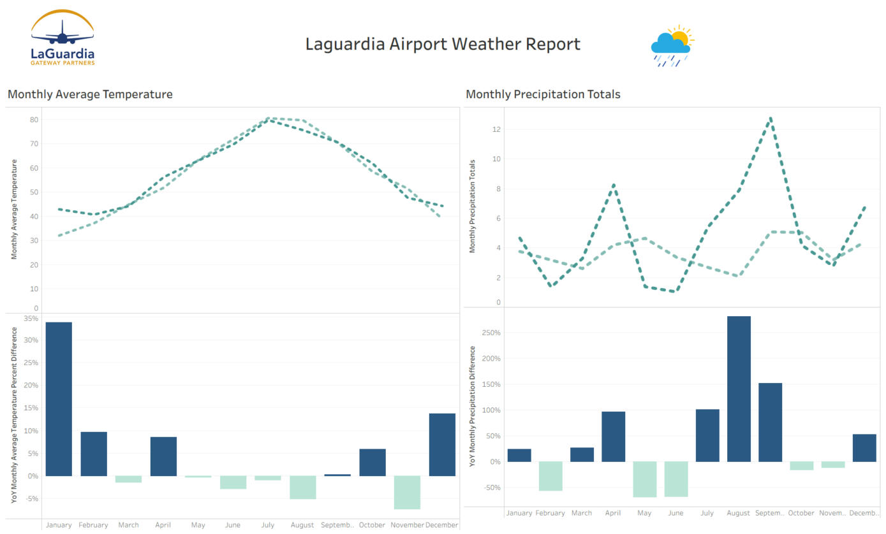

# Tableau Dashboards

Two interactive dashboards built in Tableau Desktop for the Data Visualization course (Sacred Heart University, Fall 2024).

| Dashboard | Data | Visual techniques |
|---|---|---|
| [LaGuardia Airport Weather Report](laguardia-weather/) | NOAA daily weather, LaGuardia Airport, 2022-2023 (730 days) | Monthly time series, year-over-year % difference table calculation, colour by year, branded dashboard layout |
| [Food Nutrition and Antioxidant Analysis](food-nutrition/) | Top 100 Healthiest Foods dataset (98 foods, 9 attributes) | Dual-axis bar chart, filled map, pie chart, dual-line chart, calculated field, interactive filters, extra metrics in tooltips |

> Open the workbooks with Tableau Desktop. The weather workbook also opens in the free [Tableau Public](https://public.tableau.com/app/discover) app; the food workbook uses a live CSV connection, so in Tableau Public it must be rebuilt from the CSV with an extract.

---

## 1. LaGuardia Airport Weather Report
**Question:** How did temperature and rainfall at LaGuardia Airport change month by month, and how did 2023 compare with 2022?

**Sheets**
- **Monthly Average Temperature:** average daily temperature (TAVG) by month, one line per year, with a percent-difference-from-previous-year table calculation.
- **Monthly Precipitation Totals:** total precipitation (PRCP) by month, coloured by year, with the same year-over-year comparison.
- **Dashboard:** both views combined with airport and weather branding.

**What the data shows**
- Seasonal temperature swing from about 32°F (January 2022) to about 80°F (July 2022 and 2023).
- 2023 was wetter and more volatile: September 2023 recorded **12.8 inches** of rain, the wettest month in the two years (the month of the September 29 New York City flash floods), while June 2023 had just 1.0 inch.
- Temperature extremes: 98°F on 24 July 2022 and 5°F on 4 February 2023.

Files: `LaGuardia_Weather_Report.twbx` (packaged workbook with data extract and images), `lga.csv` (raw NOAA data).

---

## 2. Food Nutrition and Antioxidant Analysis
**Question:** How do the world's "healthiest" foods compare on calories, protein, vitamin C and antioxidants, and where do they come from?

**Sheets**
- **Food Nutritional Comparison:** dual-axis chart of calories and antioxidant score per food, with protein as detail and filters for food, calories, protein and antioxidant score.
- **Global Food Distribution:** filled map by region of origin; colour = antioxidant score, size = vitamin C.
- **Nutrient Breakdown:** pie chart of calories by food, with protein and vitamin C in the tooltip.
- **Protein and Nutrient Comparison:** bar chart using a calculated field, `Protein Filter = IF [Protein (g)] > 10 THEN 1 ELSE 0 END`, to highlight high-protein foods (12 of 98), with fibre and vitamin C in the tooltip.
- **Trends Across Foods:** dual-line chart of vitamin C and antioxidant score across foods, with fibre in the tooltip.
- **Dashboard:** Food Nutrition and Antioxidant Analysis, combining the views.

**What the data shows**
- Spices dominate antioxidants: cinnamon (131,420) and turmeric (127,068) score far above any fruit; acai berries lead fruits (15,405).
- Fish lead protein: sardines, salmon, clams and tuna all have about 22 g per 100 g.
- Red bell peppers (190 mg) and papaya (168 mg) have the most vitamin C.
- The Mediterranean region is the most common origin (10 foods).

Files: `Food_Nutrition_Antioxidant_Analysis.twb` (workbook) and the source CSV. When opening the `.twb`, point Tableau to the CSV in this folder if prompted.

---

## Publishing
**Live link (recommended):** open the weather workbook in Tableau Public, choose File → Save to Tableau Public, and paste the link here.
