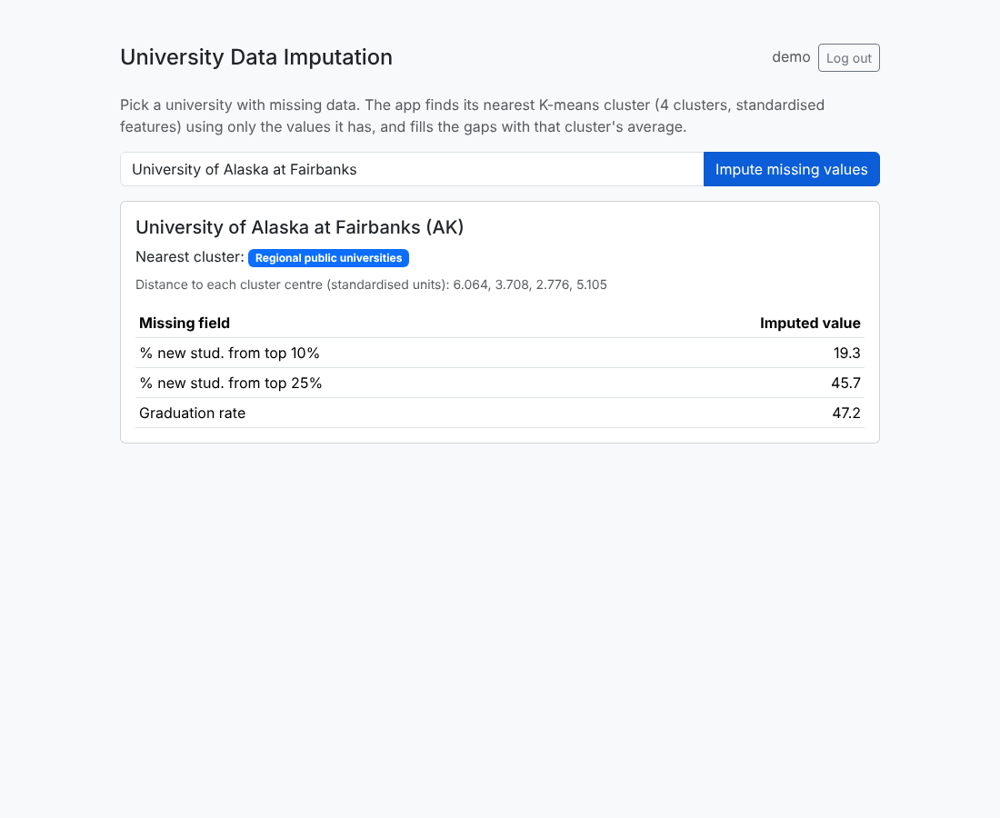
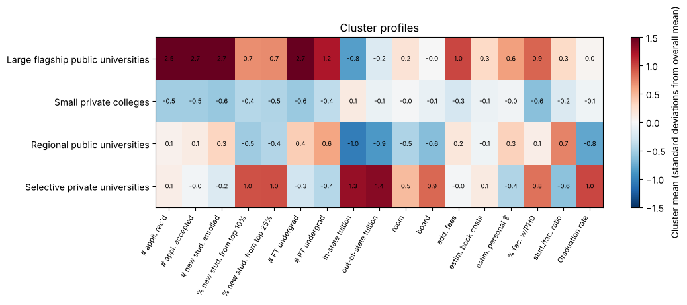

# University Clustering and Missing-Value Imputation App

**Report and slides:** [PDF report](university_clustering_report.pdf) | [PowerPoint presentation](university_clustering_presentation.pptx) | [Notebook](university_clustering.ipynb)



*Team project (Group 7: Bhavana Shree Kaki, Manisha Nallavolu, Preethi Jacinth Pasam, Rajashree Guduru), Data Mining (BUAN-670), Sacred Heart University, Spring 2025. This portfolio version corrects and extends the original submission.*

**Questions:** What natural groups of U.S. universities exist? Do they match public/private status? Can they fill in a university's missing values?

**Data:** 1,302 U.S. universities with 17 numeric measures (applications, enrolment, student quality, tuition and costs, faculty, graduation rate); 64% have at least one missing value.

## Results
| Segment | Universities | Profile |
|---|---|---|
| Large flagship public universities | 96 | ~16,000 undergraduates, selective (38% from top 10%), low in-state tuition, 61% graduation |
| Regional public universities | 363 | Lowest tuition, highest student/faculty ratio, 46% graduation |
| Small private colleges | 557 | ~1,200 undergraduates, less selective, 59% graduation |
| Selective private universities | 286 | 43% from top 10%, highest tuition, 79% graduation |

- **93% of universities fall in a cluster matching their sector**, even though sector was not used in clustering.
- **Cluster-based imputation beats mean-filling:** 24% lower error on graduation rate, 13% on student quality, 34% on out-of-state tuition (150 hidden values each).



## The web app
`app.py` (Flask): sign up, log in (hashed passwords in SQLite), type a university, and the app fills its missing values from the nearest cluster centre. `clustering.py` holds the model, so the notebook and app always agree.

**Fixes over the original submission:** login now checks the password (the original accepted any password for an existing username); the app now uses the same standardised k = 4 model as the analysis (it used unstandardised data and k = 3); redirects fixed; the secret key comes from an environment variable; front-end password storage in the browser removed.

```bash
pip install flask scikit-learn pandas
python app.py            # open http://127.0.0.1:5000
python -m pytest tests   # 4 tests: login required, wrong password rejected, Tufts imputation, unknown university
```
