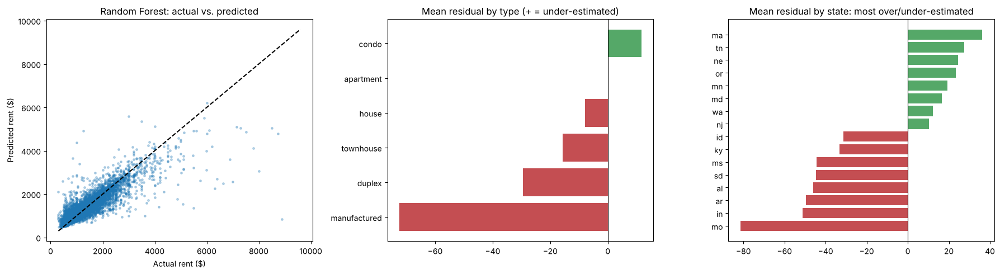

# USA Housing Rental Price Analysis

**Report and slides:** [PDF report](usa_housing_rental_analysis_report.pdf) | [PowerPoint presentation](usa_housing_rental_analysis_presentation.pptx) | [Notebook](usa_housing_rental_analysis.ipynb)

*Based on a team capstone project for Business Strategy & Analysis (BUAN-685), Sacred Heart University, Nov 2024. Team of 5; I compiled the final report. This repository is my extended analysis of the same data.*

**Business question:** What drives rental prices, and where does a pricing model systematically under- or over-estimate rent, so owners can price competitively, reduce vacancy and invest in the amenities tenants pay for?

**Data:** [USA Housing Listings (Kaggle)](https://www.kaggle.com/datasets/austinreese/usa-housing-listings): 384,977 Craigslist rental listings across 51 states, 22 columns (price, square feet, beds, baths, property type, pet/smoking/wheelchair/EV/furnished flags, laundry, parking, region, state, coordinates).
The full `housing.csv` (about 560 MB) is too large for GitHub. Download it into `data/` to reproduce the results; without it the notebook runs on `data/housing_sample.tsv`, a 632-listing extract.

**Method**
- **Cleaning:** removed 191,384 duplicate reposts (50% of listings), 2,710 impossible values (\$0 to \$2.8 billion rents, sizes over 5,000 sq ft) and 127 listings in tiny regions, leaving 190,756 listings
- **EDA:** price distribution, price vs. size by type, boxplots, correlation matrix, amenity premiums
- **Models:** mean-rent baseline, linear regression, random forest, gradient boosting; 75/25 split and cross-validation
- **Error analysis:** mean residual by property type and state to find systematic under- and over-pricing
- **Feature importance:** random forest

## Results
| Model | Test R² | MAE (per month) |
|---|---|---|
| Original course model (raw data) | 0.00 | RMSE about \$10M |
| Baseline (mean rent) | 0.00 | \$467 |
| Linear Regression | 0.48 | \$303 |
| **Random Forest** | **0.76** | **\$176** |
| Gradient Boosting | 0.74 | \$207 |

- **Cleaning turned an unusable model into a useful one:** R² went from 0.00 on the raw data to 0.76, and typical error fell to \$176 a month.
- **Location matters as much as size:** square footage, longitude, latitude and California are the top features.
- **In-unit washer/dryer:** median rent about \$1,370 vs. about \$950 with shared laundry. Pet-friendly policies show no premium, which matches the team's original t-test (p = 0.32).
- **Error analysis:** the model over-estimates rent in low-cost states (Missouri by about \$82; Indiana, Arkansas and Alabama by about \$45–50) and under-estimates it in high-cost states (Massachusetts, Oregon, Maryland, Washington, New Jersey). It pulls prices toward the national average.

Original team report: [Final_Project_Report.docx](Final_Project_Report.docx)
